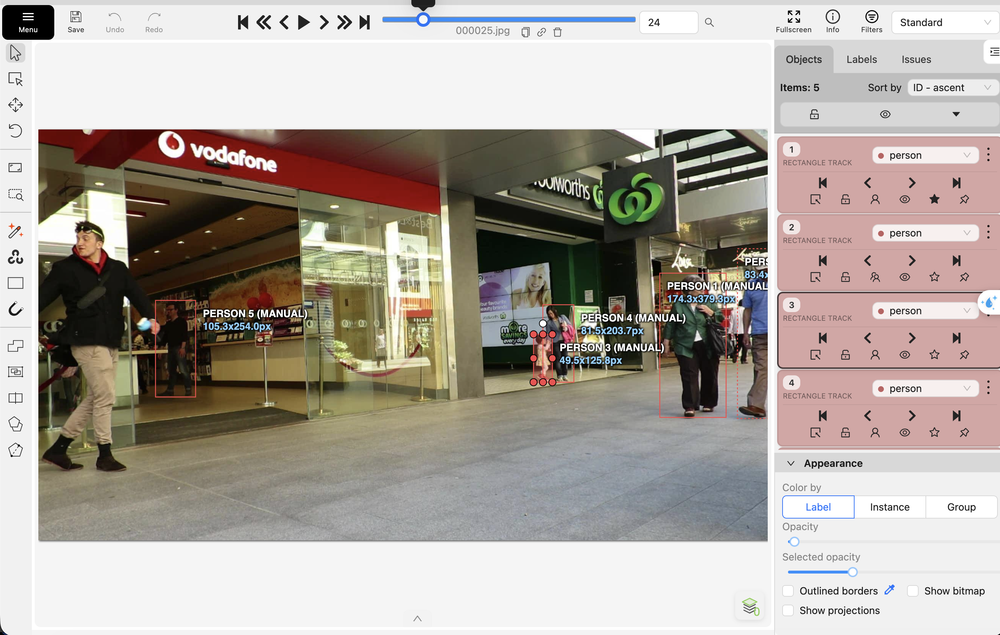
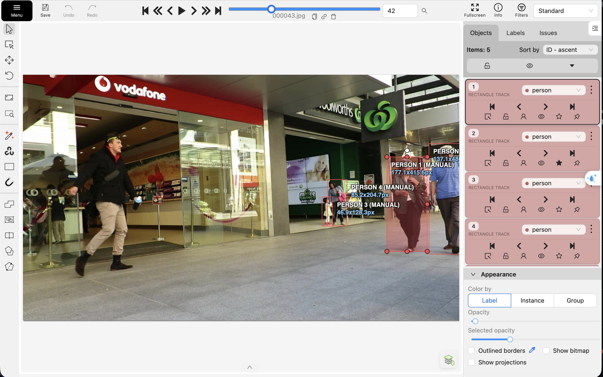
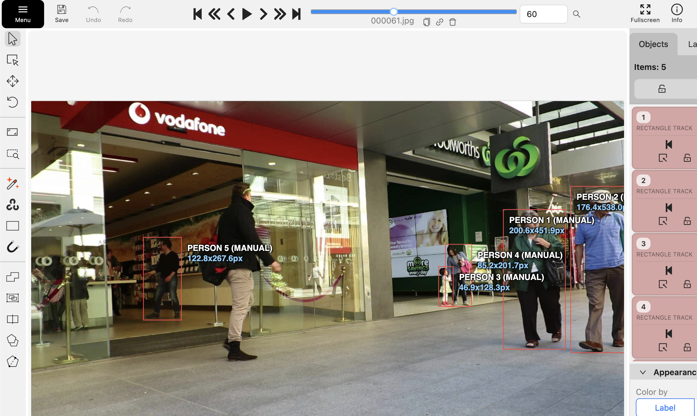
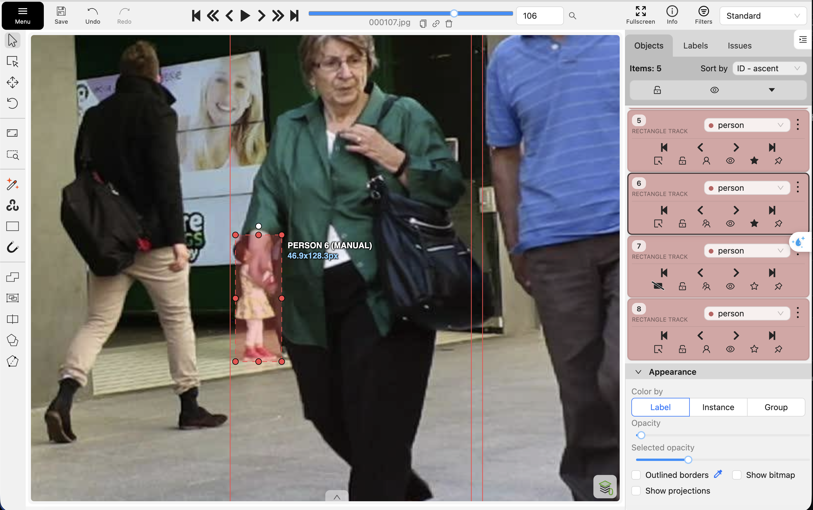
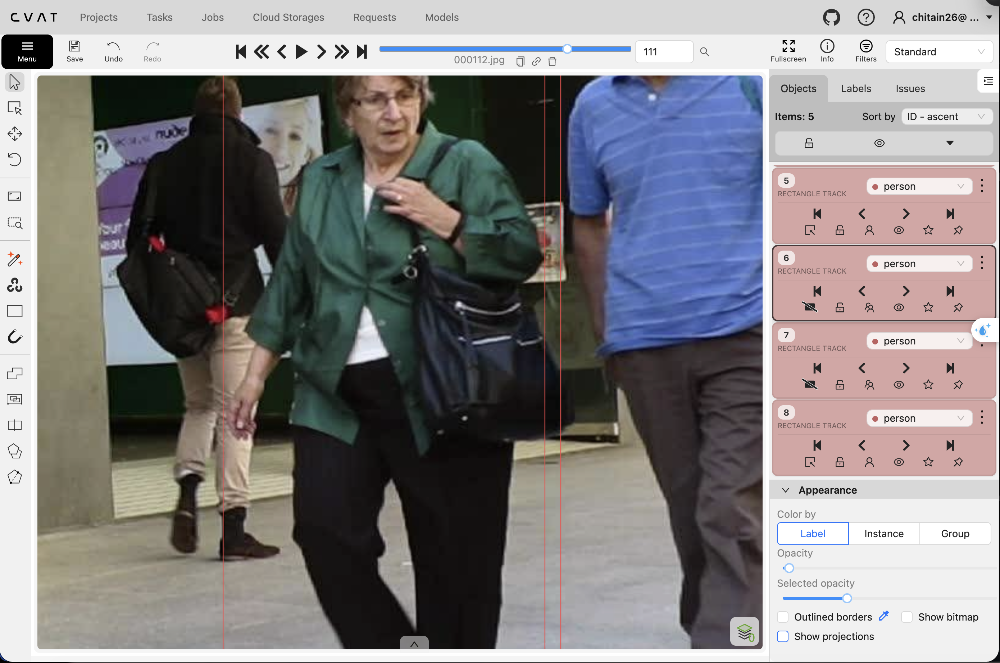
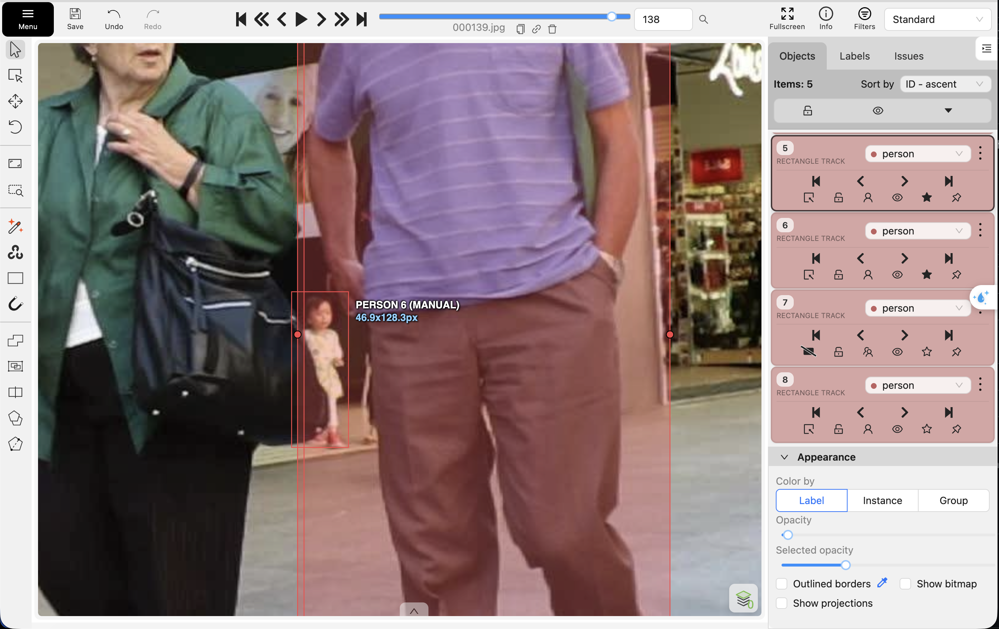

# Báo cáo cá nhân — Nguyễn Chí Tài — 2A202603223

Báo cáo tổng hợp từ file nhãn xuất và ghi nhận thực tế của học viên. Đã có ảnh minh chứng P1; các lỗi cờ phát hiện khi đối chiếu bổ sung được ghi riêng ở mục 4 để sửa trên CVAT trước khi nộp.

Đoạn video: MOT17-09, 150 frame (CVAT: 0–149; MOT: 1–150), nguồn MOTChallenge, giấy phép CC BY-NC-SA 3.0.

## 0. Thông tin học viên

- Họ tên: Nguyễn Chí Tài.
- MSSV: 2A202603223.
- Mã đề: B (task `DAY05-MOT17-09-B-2A202603223`).
- Email tài khoản CVAT: chitain26@gmail.com.
- Link repository: https://github.com/nguyen-chi-tai-2005/K5-L2-DAY5-NguyenChiTai-2A202603223-MOTTracking
- Giờ bắt đầu: 17:00 ngày 13/11/2026 (GMT+7).
- Giờ kết thúc: 19:30 ngày 13/11/2026 (GMT+7).
- Tổng thời gian buổi làm bài: 150 phút; riêng gán nhãn khoảng 100 phút. Không có ghi chép thời gian riêng cho từng người.
- Công cụ: CVAT local, nhãn `person`, Rectangle Track; nguồn track trong XML là `manual`.

## 1. Xem trước đoạn video (CP0)

Các quan sát dưới đây do học viên cung cấp khi hoàn thiện báo cáo; không có nhật ký riêng để xác nhận thời điểm ghi trước khi vẽ. Số frame dùng theo CVAT (0–149).

| Mã | Nhận diện | Chuyển động / mốc đáng chú ý | Đoạn bị che theo file xuất |
|---|---|---|---|
| P1 | Người mặc đồ tối trong cửa hàng Vodafone | Đi sang phải; có lúc đi lùi, quay lưng. Khoảng frame 93 đổi hướng để ra khỏi cửa hàng | Vắng 34–36 và 38–50; có che một phần quanh các đoạn này |
| P2 | Người áo xanh lá, mang túi đen | Đi thẳng với tốc độ tương đối đều, có mặt từ đầu đến cuối | Không bật `occluded` hoặc `outside` |
| P3 | Người áo xanh dương, đội mũ sáng | Frame 0 chỉ lộ phần tay ở mép phải; học viên xác nhận cùng người. Thấy đầy đủ từ khoảng frame 37, sau đó đi thẳng đều | XML bật `occluded` ở 0–29; học viên không ghi nhận bị che thêm ở đoạn sau |
| P4 | Em bé | Đi thẳng đến khoảng frame 36 rồi dừng; vẫn có thể bị người đi qua phía trước che | File hiện tại đặt vắng 109–135 và từ 145; có mốc outside cần sửa theo mục 4 |
| P5 | Người lớn mang túi hồng, đi cùng em bé | Đi thẳng đến khoảng frame 36 rồi dừng; đoạn cuối bị người phía trước che, không phải đi ra khỏi cảnh ở frame 103 | File hiện tại chỉ có box 0–102; cờ outside từ 103 cần sửa ở những frame còn nhìn thấy |

Ánh xạ dùng để đối chiếu bảng nhận diện và hai file xuất:

| Mã | ID XML | ID MOT | Frame đầu–cuối có box |
|---|---:|---:|---|
| P1 | 4 | 5 | 0–149 |
| P2 | 0 | 1 | 0–149 |
| P3 | 1 | 2 | 0–149 |
| P4 | 2 | 3 | 0–144 |
| P5 | 3 | 4 | 0–102 |

Đối chiếu ảnh gốc bổ sung xác nhận: đứng yên không đồng nghĩa với biến mất. P5 còn nhìn thấy một phần ở frame 103–105; P4 còn nhìn thấy một phần ở frame 145–146. Vì vậy, số frame có box trong các bảng là thống kê của bản xuất hiện tại, chưa chứng minh nhãn đoạn cuối đã đúng. Cần sửa cờ theo ảnh thực tế rồi xuất và thống kê lại; xem mục 4.

## 2. Keyframe và thời gian (CP1, CP4)

Số liệu lấy từ script tự kiểm trên hai ZIP hiện tại; keyframe có `outside=1` không nằm trong số keyframe hiển thị dưới đây. Ánh xạ mã người được trình bày ở mục 1.

| Mã | Số keyframe | Keyframe ở frame CVAT | Số frame có mặt | Keyframe / 100 frame | Thời gian (phút) | Chỗ khó thực tế |
|---|---:|---|---:|---:|---|---|
| P1 | 19 | 0, 10, 20, 29, 30, 37, 51, 53, 54, 60, 70, 80, 90, 100, 110, 120, 130, 140, 149 | 134 | 14.2 | Không ghi riêng | Theo dõi lúc đi lùi, quay lưng, bị che và đổi hướng ở frame 93 |
| P2 | 60 | 0, 1, 2, 3, 4, 6, 7, 8, 9, 10, 11, 12, 13, 15, 16, 17, 18, 19, 20, 21, 22, 23, 24, 25, 26, 28, 35, 48, 58, 60, 68, 70, 72, 78, 79, 88, 98, 103, 106, 107, 109, 110, 111, 116, 118, 122, 125, 126, 127, 128, 130, 131, 133, 135, 136, 137, 138, 139, 140, 149 | 150 | 40.0 | Không ghi riêng | Theo dõi hộp theo người đi thẳng từ đầu đến cuối |
| P3 | 53 | 0, 10, 20, 30, 31, 40, 41, 42, 43, 46, 47, 48, 49, 50, 51, 52, 53, 63, 73, 83, 86, 87, 93, 96, 103, 105, 106, 107, 108, 113, 114, 115, 116, 117, 118, 122, 123, 124, 126, 127, 128, 129, 130, 132, 135, 136, 138, 142, 143, 144, 145, 147, 149 | 150 | 35.3 | Không ghi riêng | Nhận diện lúc chỉ lộ tay ở mép ảnh; thấy đầy đủ khoảng frame 37 |
| P4 | 15 | 0, 10, 20, 30, 37, 40, 50, 106, 136, 137, 138, 139, 140, 141, 143 | 118 | 12.7 | Không ghi riêng | Khó nhất: mất hẳn rồi xuất hiện lại sau người phía trước |
| P5 | 12 | 0, 10, 20, 30, 31, 32, 33, 34, 40, 50, 60, 102 | 103 | 11.7 | Không ghi riêng | Theo dõi lúc dừng và bị che; cần sửa cờ outside đặt sớm ở đoạn cuối |
| **Tổng** | **159** | — | **655** | **24,3** | Khoảng 100 | — |

Mật độ toàn bài = 159 ÷ 655 × 100 ≈ **24,3 keyframe / 100 frame**. Tổng 655 là tổng frame có box của 5 người, không phải độ dài video.

Tổng thời gian gán nhãn khoảng 100 phút; không chia đều thành 20 phút/người vì không có số đo riêng. Phần khó nhất là P4, khi em bé bị che rồi hiện lại.

P2 có nhiều keyframe nhất (60), tiếp đến P3 (53). P2 có mặt đủ 150 frame, chuyển động tương đối đều và không có đoạn `Q`/`O`. Tuy nhiên, số frame có mặt và số keyframe là hai đại lượng khác nhau: P3 cũng có mặt đủ 150 frame nhưng chỉ có 53 keyframe. Việc không bị che không tự tạo thêm keyframe; hiện không có ghi chép đủ chi tiết để kết luận vì sao P2 được chỉnh hộp nhiều hơn. Khi làm lại, có thể kiểm tra xem các đoạn đi thẳng đều có cần nhiều keyframe như hiện tại không.

## 3. Đoạn bị che (CP2)

### Đoạn P1 theo yêu cầu bài

Theo ánh xạ mục 1, P1 là XML track 4 / MOT ID 5. Các mốc dưới đây đọc từ nhãn xuất; học viên xác nhận đã kiểm tra và thấy đúng diễn biến che một phần, mất hẳn, hiện lại một phần rồi thấy đầy đủ.

| Mốc | Frame CVAT |
|---|---:|
| Bắt đầu `occluded=1` | 29 |
| `outside=1` lần đầu | 34 |
| Hiện lại, `outside=0` | 37 |
| Lại `outside=1` | 38 |
| Hiện lại, `outside=0` | 51 |
| Thấy rõ, `occluded=0` sau lần hiện lại thứ hai | 53 |

Có hai đoạn vắng: frame 34–36 (3 frame = 0,10 giây) và 38–50 (13 frame ≈ 0,43 giây), ở 30 fps. XML còn bật lại `occluded` ở frame 54–59 và tắt ở frame 60.

Tôi giữ cùng ID trước và sau hai đoạn vắng. Mỗi khoảng vắng đều dưới 60 frame; quần áo khớp và vị trí hiện lại phù hợp với hướng đi sang phải của P1. Tôi cũng chú ý lúc người này đi lùi, quay lưng và đổi hướng ở khoảng frame 93, thay vì chỉ nhận diện qua tư thế tại một frame.

Ảnh minh chứng P1 do học viên chụp bổ sung ngày 14/11/2026:







Trong ba ảnh, P1 của đề tương ứng object hiển thị `PERSON 5` (XML ID 4 / MOT ID 5), không phải object `PERSON 1` là người áo xanh lá. Ảnh frame 42 cho thấy hộp không hiển thị; trạng thái `outside=1` của P1 được đối chiếu trong XML vì thẻ object P1 không nằm trong vùng panel đang chụp.

### Minh chứng bổ sung hiện có: P4 (em bé)

XML track 2 / MOT ID 3 bật `occluded` từ frame 106, `outside` từ 109, hiện lại tại 136 và tắt `occluded` ở 138. Đoạn vắng 109–135 dài **27 frame = 0,90 giây**; trước và sau dùng cùng track. Học viên đã xem lại theo từng người và chỉnh cờ khi em bé hiện lại; đây là đoạn khó nhất trong quá trình gán nhãn.







Nguồn ảnh: ảnh chụp CVAT của học viên, MOT17, MOTChallenge (Milan et al., 2016). Số ID trên giao diện trong ảnh khác ID xuất XML/MOT; đối chiếu bằng người và frame.

## 4. Tự review ID (CP3)

Tôi đã kiểm tra hai lượt: theo từng người từ cuối về đầu và theo toàn cảnh với bước nhảy khoảng 10 frame. Tôi ghi nhận một lỗi cụ thể ở P4; không bổ sung các lỗi giả định để tăng số dòng trong bảng.

| Frame | Mã người | Loại lỗi | Mô tả | Phát hiện ở lượt | Đã sửa? |
|---|---|---|---|---|---|
| Khoảng 125–145 | P4 | `flag` | Cần chỉnh lại cờ khi em bé hiện lại sau đoạn bị che hoàn toàn; phân biệt mất hẳn, hiện lại một phần và thấy rõ | Lượt 1, theo từng người | Có; chỉnh `outside` và `occluded` theo mức độ nhìn thấy, giữ track cũ |

Bản xuất sau sửa: P4 vắng 109–135, tắt `outside` ở frame 136, tắt `occluded` ở frame 138; từ frame 145 bật lại `outside`. Khoảng 125–145 là vùng học viên kiểm tra và sửa, không có nghĩa em bé nhìn thấy trong toàn bộ khoảng này. Không có file trước sửa để xác định chính xác từng frame bị gán cờ sai ban đầu.

| `id_switch` | `fragmentation` | `lost` | `merge` | `false_track` | `drift` | `flag` |
|---:|---:|---:|---:|---:|---:|---:|
| 0 | 0 | 0 | 0 | 0 | 0 | 1 |

Số trên là lỗi đã ghi nhận cụ thể trong hai lượt tự review, không phải kết quả chấm với ground truth. Học viên còn gặp hiện tượng hộp nội suy lệch khi nhảy khoảng 10 frame, nhưng không ghi frame hoặc số lần cụ thể nên không cộng thành một số lỗi `drift` xác định trong bảng.

Lượt theo toàn cảnh giúp tôi nhìn rõ quỹ đạo, tương tác giữa các người và nguyên nhân bị che, từ đó nhận ra những vùng cần xem kỹ. Tôi không ghi nhận thêm lỗi riêng chỉ xuất hiện ở lượt 2. Lỗi P4 nêu trên được phát hiện khi kiểm tra theo từng người.


### Đối chiếu kỹ thuật bổ sung sau hai lượt tự review

Đây là kết quả xem lại ảnh gốc khi hoàn thiện báo cáo, tách khỏi một lỗi học viên đã tự ghi nhận phía trên. Các cờ dưới đây **chưa được sửa trong CVAT hoặc hai ZIP hiện tại**:

| Người | Frame xác nhận còn nhìn thấy một phần | Trạng thái file hiện tại | Cách sửa cần thực hiện |
|---|---|---|---|
| P5 | 103–105 | `outside=1` từ 103 | Giữ ID cũ, tắt `outside`, bật `occluded`, hộp vẫn bao toàn thân ước lượng; kiểm tra tiếp từng frame đến hết đoạn |
| P4 | 109–110 | `outside=1` từ 109 | Vẫn còn phần cơ thể nhìn thấy: cần dùng `occluded` thay cho `outside` ở các frame này; kiểm tra lại mốc mất hẳn |
| P4 | 145–146 | `outside=1` từ 145 | Vẫn lộ một phần cơ thể: tắt `outside`, bật `occluded`; kiểm tra tiếp các frame 147–149 để đặt mốc mất hẳn đúng |

Đây là lỗi cờ `flag`, có thể gây bỏ sót box (`lost`). Các frame nêu trên là mốc đã xác nhận từ ảnh, không khẳng định rằng các khoảng ngoài chúng đều mất hẳn. Khi sửa cần rà đủ đoạn, không kéo `outside=0` hoặc `outside=1` cho cả khoảng chỉ dựa trên hai mốc. Sau khi lưu CVAT, xuất lại cả hai ZIP, chạy tự kiểm và cập nhật số box/keyframe trong mục 2 và mục 5.

## 5. File xuất và kết quả tự kiểm (CP4)

| Kiểm tra | Kết quả |
|---|---|
| File MOT 1.1 | `src/exports/NguyenChiTai_mot.zip` |
| File CVAT for video 1.1 | `src/exports/NguyenChiTai_cvat_video.zip` |
| Số track ID MOT | 5 |
| Tổng box MOT | 655 |
| Track trong XML | 5, nhãn `person`, nguồn `manual` |
| Frame outside không có dòng MOT | Khớp toàn bộ trạng thái visible/outside XML với sự có mặt của box MOT (XML ID + 1 = MOT ID). |
| Job completed | Đã Completed, theo xác nhận của học viên. |

```text
Số track ID: 5 | Tổng số box: 655
[OK] Đúng 5 track ID.
Tổng: 159 keyframe / 655 frame có mặt = 24.3 keyframe / 100 frame
[OK] Đọc được 5 track từ annotations.xml.
Lỗi: 0 | Cảnh báo: 0
Đạt.
```

Kết quả này thuộc bản ZIP hiện tại và chỉ phản ánh các kiểm tra tự động. Các lỗi cờ phát hiện từ ảnh gốc tại mục 4 vẫn cần xử lý; kết quả 0 lỗi của script không thay thế kiểm tra hình ảnh.

Kết quả đầy đủ được lưu tại [ket_qua_tu_kiem.txt](ket_qua_tu_kiem.txt). Đây là kiểm tra tự động về cấu trúc và một số dấu hiệu lỗi; vẫn cần review hình ảnh để xác nhận đúng người và hộp.

Khó khăn kỹ thuật đã gặp: môi trường Python 3.9.6 không cài được các phụ thuộc yêu cầu; đã chuyển sang `.venv311`. Bản ZIP CVAT trước chứa thẻ `image` nên script không tìm thấy track; bản hiện tại đã có 5 track và vượt qua tự kiểm.

## 6. Ba câu kết

1. **Nếu được gán lại, tôi sẽ đặt keyframe khác ở đâu? Vì sao?**

   Tôi sẽ tiếp tục làm trước những người đi thẳng, không bị che, rồi dành thời gian kiểm tra chi tiết các người bị che một phần hoặc hoàn toàn. Với P4, tôi sẽ kiểm tra sát các mốc mất hẳn và hiện lại; với P1, chú ý đoạn đổi hướng quanh frame 93. Khi bước nhảy khoảng 10 frame làm hộp lệch khỏi người, tôi sẽ kiểm tra các frame ở giữa và thêm hoặc chỉnh keyframe tại chỗ cần thiết. Cách làm này giúp giảm bỏ sót và tránh để nội suy đi qua đoạn thay đổi chuyển động mà chưa kiểm tra.

2. **Có chỗ nào tôi không chắc cùng ID hay ID mới? Tôi đã quyết định thế nào?**

   Tôi không gặp trường hợp buộc phải tạo ID mới do vượt ngưỡng 2 giây. Các khoảng vắng đã ghi trong file xuất đều dưới 60 frame. Tôi giữ track cũ khi người hiện lại, đồng thời đối chiếu ngoại hình và hướng đi; với P1, tôi dựa vào quần áo và vị trí xuất hiện tiếp theo. Ngưỡng thời gian được dùng cùng các dấu hiệu nhận diện, không phải căn cứ duy nhất.

3. **Lỗi đã gặp có thể làm hệ thống dự đoán sai chuyển động thế nào? Ảnh hưởng MOTA hay IDF1?**

   Hiện tượng tôi gặp là hộp nội suy có thể lệch quỹ đạo khi nhảy khoảng 10 frame. Đây là lỗi `drift` về vị trí hộp, chưa đủ căn cứ gọi là `id_switch`. Trong hệ thống xe tự lái, nếu vị trí hộp sai được dùng để ước lượng chuyển động, hệ thống có thể suy ra sai hướng đi hoặc tốc độ của người. Việc giữ `outside` khi người đã hiện lại cũng có thể khiến hệ thống hiểu rằng người vẫn chưa có mặt.

   Theo tài liệu chấm của repo, box trôi làm IoU xuống dưới ngưỡng ghép có thể tạo FN/FP và giảm MOTA; IDF1 cũng có thể giảm vì thiếu các cặp nhận diện đúng. Nếu lỗi thực sự là đổi ID hoặc chia một người thành nhiều ID kéo dài, IDF1 phản ánh vấn đề duy trì danh tính rõ hơn. Không có kết quả so với ground truth nên tôi không kết luận mức giảm cụ thể hay chỉ số nào giảm nhiều hơn cho job này.

## Bonus (nếu làm)

Không thực hiện.

## 7. Tài liệu tham khảo và công cụ AI đã dùng

- MOT17, MOTChallenge (Milan et al., 2016); dữ liệu theo giấy phép CC BY-NC-SA 3.0 như repo quy định.
- Tài liệu nội bộ: `docs/GUIDELINE.md`, `CHECKPOINTS.md`, `SUBMISSION.md`, `docs/MOT_FORMAT.md`, `RULES.md`.
- CVAT local: gán nhãn thủ công Rectangle Track và xuất MOT 1.1 / CVAT for video 1.1.
- Script `src/check_submission.py`: thống kê track, keyframe, khoảng vắng và kiểm tra file xuất.
- ChatGPT/Codex: giải thích cách dùng CVAT, lỗi môi trường và định dạng xuất; hỗ trợ tổng hợp số liệu từ ZIP và soạn phần mô tả có bằng chứng. AI không sinh/sửa box hoặc track ID. Nội dung tự review và ba câu kết dựa trên ghi nhận do học viên cung cấp; AI hỗ trợ biên tập câu chữ và giải thích sự khác biệt giữa drift, lỗi cờ và đổi ID. Không tạo thêm lỗi hoặc thời gian không có ghi chép.
